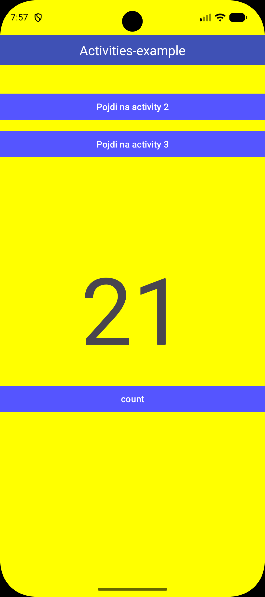
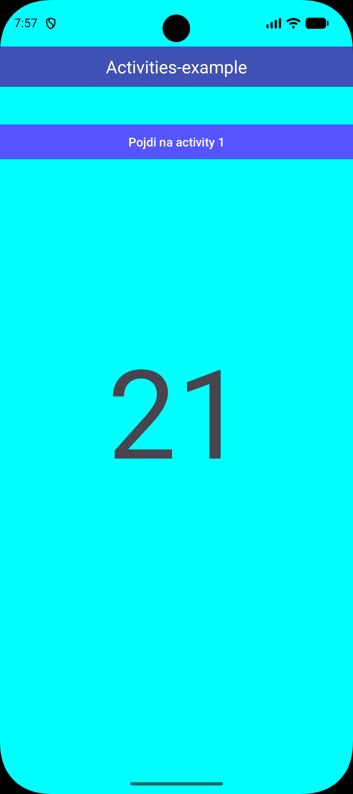
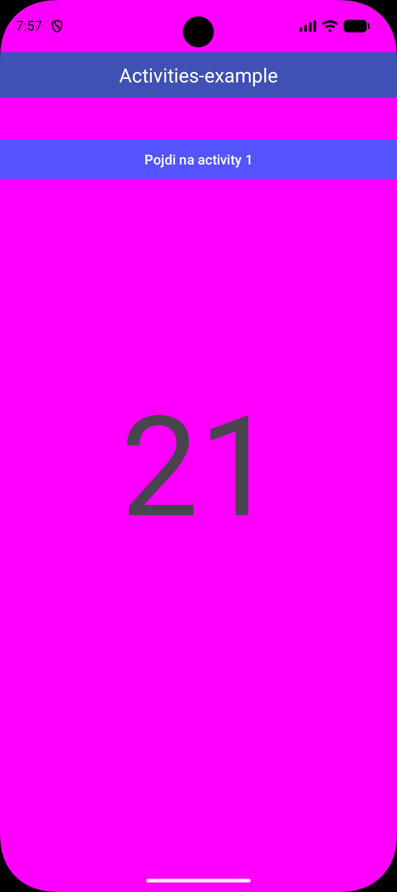

# Različne aktivnosti

Android aplikacija za učenje navigacije med aktivnostmi (activities) in prikazovanja števca.

Aplikacija vsebuje tri preproste zaslone z različnimi barvami in velikim besedilom, ki simulirajo navigacijo v aplikaciji.

## Funkcionalnosti
- prehod med Activity 1, Activity 2 in Activity 3
- prikaz števca na sredini zaslona
- preprosta in vizualno jasna UI
- primer uporabe za učenje Android development osnov

## Zaslonske slike

### Glavni zaslon / Activity 1

### Activity 2

### Activity 3

